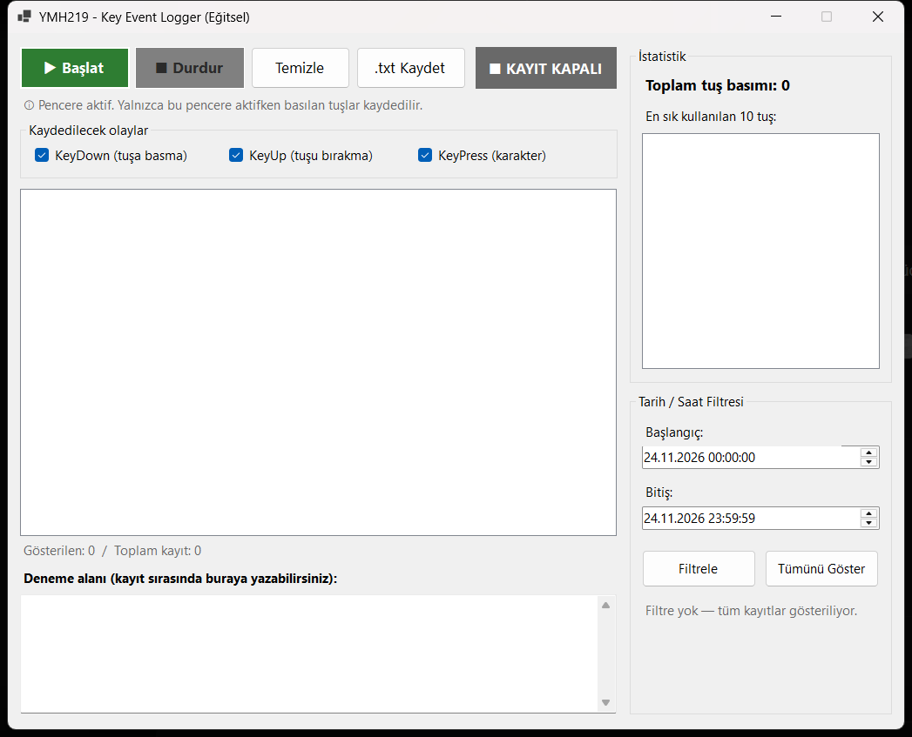
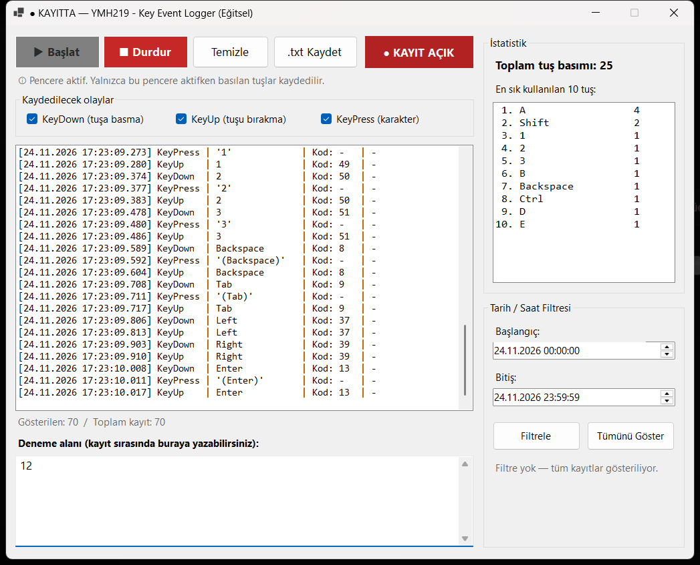

# YMH219-KeyEventLogger

Nesne Tabanlı Programlama (YMH 219) dersi ek uygulama ödevi: Windows Forms'ta **klavye olaylarının (KeyDown, KeyUp, KeyPress) nasıl yakalandığını** ve olay bilgilerinin uygulama içinde nasıl işlendiğini gösteren **eğitsel** bir Key Event Logger.

Uygulama **yalnızca kendi penceresi aktifken** basılan tuşları, zaman bilgisiyle birlikte listeler ve istenirse yerel bir `.txt` dosyasına kaydeder.

## Kapsam ve Güvenlik Sınırı

Bu uygulama gerçek bir sistem keylogger'ı **değildir**:

- Tuşlar yalnızca `Form.KeyPreview` ile, **uygulamanın kendi penceresi odaktayken** yakalanır.
- Global keyboard hook **yoktur**; başka uygulamalardaki tuşlar kaydedilmez.
- Gizli/arka planda çalışma, Windows açılışında otomatik başlama **yoktur**.
- Kayıtlar ağ üzerinden **gönderilmez**; yalnızca kullanıcı isterse seçtiği yerel bir dosyaya yazılır.
- Pencere odağı kaybettiğinde arayüzde uyarı gösterilir.

## Kullanılan Teknolojiler

- C# / .NET 8 (`net8.0-windows`)
- Windows Forms (ListBox, TextBox, GroupBox, CheckBox, DateTimePicker, SaveFileDialog)
- `System.IO.StreamWriter` ile dosya yazma
- Harici NuGet paketi **yok**

## Kurulum ve Çalıştırma

**Visual Studio ile**
1. Depoyu klonlayın: `git clone https://github.com/<kullanici-adi>/YMH219-KeyEventLogger.git`
2. `YMH219-KeyEventLogger.sln` dosyasını Visual Studio ile açın.
3. `F5` ile çalıştırın.

**Komut satırı ile**
```
dotnet run --project KeyEventLogger
```

## Kullanım

1. **▶ Başlat** ile kaydı açın. Sağ üstteki gösterge **● KAYIT AÇIK** olur, pencere başlığında "KAYITTA" yazar.
2. Pencere aktifken herhangi bir tuşa basın (isterseniz alttaki deneme alanına yazın).
3. Hangi olayların kaydedileceğini **KeyDown / KeyUp / KeyPress** kutucuklarıyla seçin.
4. **■ Durdur** ile kaydı durdurun, **Temizle** ile kayıtları silin.
5. **.txt Kaydet** ile listede görünen kayıtları bir metin dosyasına kaydedin.

Kayıt satırı biçimi:
```
[24.11.2026 17:23:09.708] KeyDown  | Tab             | Kod: 9   | -
[24.11.2026 17:23:09.711] KeyPress | '(Tab)'         | Kod: -   | -
[24.11.2026 17:23:09.717] KeyUp    | Tab             | Kod: 9   | -
```
`[Zaman] Olay | Tuş | Sanal tuş kodu | Değiştirici (Ctrl/Shift/Alt)`

## Temel Özellikler

- Basılan tuşun adı ve zamanı (milisaniye hassasiyetinde) ListBox'ta gösterilir.
- Başlat / Durdur butonları ile kayıt durumu kontrol edilir.
- Temizle butonu ile kayıtlar silinir (onay sorulur).
- Kayıtlar `.txt` dosyasına kaydedilebilir; dosya hataları uygulamayı kapatmadan kullanıcıya bildirilir.
- Kayıt durumu renkli gösterge ve pencere başlığı ile açıkça belirtilir.
- *İsteğe bağlı:* Toplam tuş sayısı ve en sık kullanılan 10 tuşun istatistiği.
- *İsteğe bağlı:* Kayıtları tarih/saat aralığına göre filtreleme.

## Proje Yapısı

```
KeyEventLogger/
├── Program.cs               Giriş noktası
├── MainForm.cs              Klavye olayları, butonlar, filtre ve arayüz güncelleme
├── MainForm.Designer.cs     Form kontrolleri
├── Models/
│   ├── KeyEventType.cs      Olay türü: KeyDown / KeyUp / KeyPress
│   ├── KeyLogEntry.cs       Tek bir kayıt: zaman, olay, tuş, kod, değiştirici
│   └── KeyLogger.cs         Kayıt durumu, kayıt listesi, istatistik, filtre, EntryAdded olayı
└── Services/
    └── LogFileService.cs    Kayıtları StreamWriter ile .txt dosyasına yazma
```

## Ekran Görüntüleri

| Başlangıç | Kayıt sırasında |
|---|---|
|  |  |

## Bilinen Sınırlamalar / Geliştirme Notları

- `PrintScreen` gibi bazı tuşlar Windows tarafından işlendiği için KeyDown olayı üretmez.
- `Alt+F4`, `Win` gibi sistem kısayolları Windows tarafından da işlenir.
- KeyDown fiziksel tuşu verir (ör. Türkçe klavyede `ş` için `Oem1`), KeyPress ise üretilen karakteri verir (`'ş'`). Bu fark bilerek iki ayrı satır olarak gösterilir.
- Kayıtlar yalnızca bellekte tutulur; uygulama kapanınca `.txt` olarak kaydedilmemiş kayıtlar silinir.

## Öğrenci

- **Ad Soyad:** Arda Yeşil
- **Öğrenci No:** 250542013
